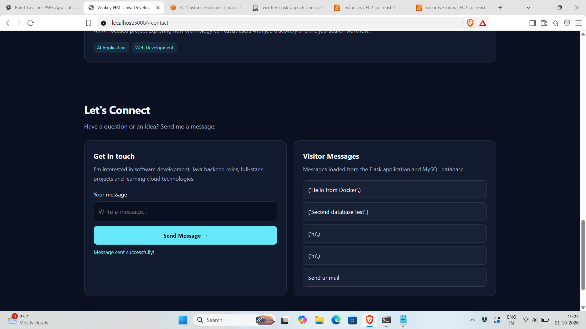
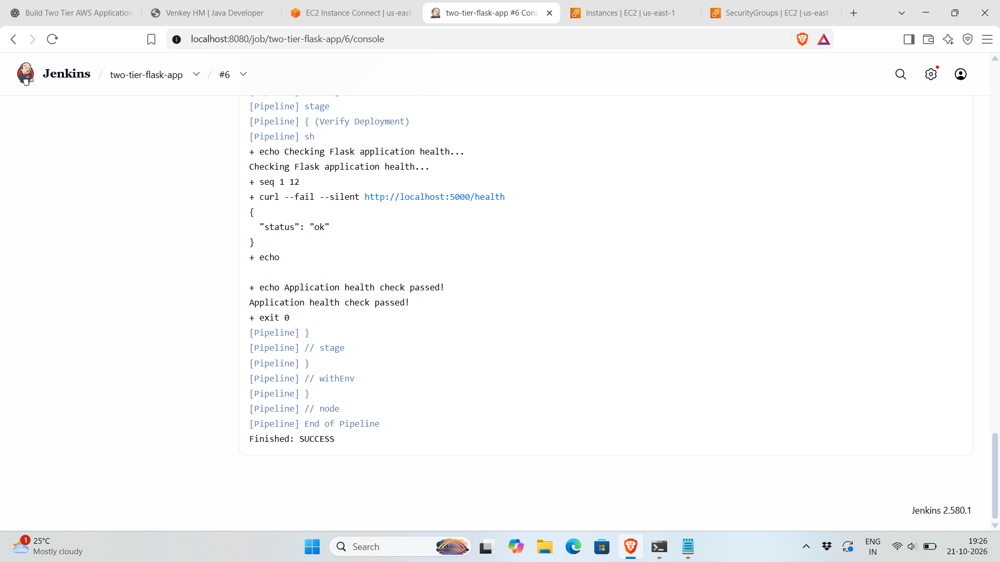

# Two-Tier Flask Application on AWS with Jenkins CI/CD

A two-tier web application built using Flask and MySQL, containerized with Docker and Docker Compose, and deployed on AWS EC2 using a Jenkins CI/CD pipeline.

## Project Overview

This project demonstrates how to deploy a Flask web application connected to a MySQL database. Docker manages containerization, Docker Compose manages the multi-container environment, and Jenkins automates the build, deployment, and health verification process.

## Technologies Used

| Technology | Purpose |
|---|---|
| AWS EC2 | Hosts the application and deployment tools |
| Ubuntu | Server operating system |
| Python and Flask | Web application |
| MySQL | Database |
| Docker | Containerization |
| Docker Compose | Multi-container management |
| Jenkins | CI/CD automation |
| Git and GitHub | Version control and source code hosting |
| Linux and Bash | Server administration and automation |

## Architecture

```text
Developer
    |
    v
GitHub Repository
    |
    v
Jenkins CI/CD Pipeline
    |
    v
Build Docker Image
    |
    v
Docker Compose Deployment
    |
    +--------------------+
    |                    |
    v                    v
Flask Application     MySQL Database
Container             Container
                           |
                           v
                    Persistent Volume
                       mysql_data
```

## Project Features

- Flask web application connected to MySQL.
- Separate application and database containers.
- Docker Compose for managing multiple containers.
- Jenkins pipeline for automated build and deployment.
- Health endpoint for application verification.
- Persistent database storage using a named Docker volume.
- GitHub integration for source code management.

## Repository Structure

```text
DevOps-Project-Two-Tier-Flask-App/
├── app.py
├── Dockerfile
├── docker-compose.yml
├── Jenkinsfile
├── message.sql
├── requirement.txt
├── README.md
├── diagrams/
├── screenshots/
│   ├── application.png
│   └── jenkins.png
└── templates/
    └── index.html
```

## Deployment Steps

### Step 1: Launch an AWS EC2 Instance

Launch an Ubuntu EC2 instance and connect to it using SSH.

Ensure that the security group allows SSH access from your IP address. Configure application and Jenkins access carefully rather than opening all ports to the internet.

### Step 2: Install the Required Tools

Install and configure Docker, Docker Compose, Git, and Jenkins on the EC2 instance.

Verify the installations:

```bash
docker --version
docker compose version
git --version
java -version
```

### Step 3: Clone the GitHub Repository

```bash
git clone https://github.com/Venky0426/DevOps-Project-Two-Tier-Flask-App.git
cd DevOps-Project-Two-Tier-Flask-App
```

### Step 4: Configure the Application

Review the Flask application, Dockerfile, Docker Compose configuration, database initialization SQL, and Jenkinsfile.

Configure database credentials securely using environment variables or Jenkins credentials. Do not commit real secrets to GitHub.

### Step 5: Build and Start the Application

Validate the Compose configuration:

```bash
docker compose -p devops-project-two-tier-flask-app config --quiet
```

Build and start the containers:

```bash
docker compose -p devops-project-two-tier-flask-app up -d --build
```

Check the running containers:

```bash
docker ps
```

### Step 6: Configure Jenkins

Open the Jenkins dashboard through a secured connection.

Create a Pipeline job and configure **Pipeline script from SCM** with Git as the source control system.

Use the repository URL:

```text
https://github.com/Venky0426/DevOps-Project-Two-Tier-Flask-App.git
```

Set the branch to `main` and the script path to `Jenkinsfile`.

Ensure Jenkins has the required permissions and environment configuration to run Docker Compose and access the application.

### Step 7: Run the Jenkins Pipeline

Run the pipeline using **Build Now**.

The pipeline performs these stages:

1. **Clone Repository:** Retrieves the latest source code from GitHub.
2. **Build Image:** Builds the Flask application Docker image.
3. **Deploy Application:** Uses Docker Compose to deploy the application and database services.
4. **Verify Deployment:** Checks the application health endpoint and retries if the application is not immediately ready.

Review the console output and confirm that all stages complete successfully.

### Step 8: Verify the Application

Check the health endpoint on the EC2 instance:

```bash
curl -i http://localhost:5000/health
```

Expected response:

```json
{
  "status": "ok"
}
```

If accessing the application from your laptop, use an appropriately secured connection, such as an SSH tunnel.

### Step 9: Verify the Database

The MySQL database is named `devops`, and the `messages` table stores application messages.

Run these commands in the MySQL client:

```sql
USE devops;
SHOW TABLES;
DESCRIBE messages;
SELECT * FROM messages;
```

Confirm that the table exists and that submitted messages are stored correctly.

The named Docker volume `mysql_data` provides persistent database storage. Recreating containers normally preserves data stored in this volume.

## Screenshots

### 1. Application Homepage

This screenshot shows the deployed Flask application's user interface.



### 2. Jenkins CI/CD Pipeline

This screenshot shows the Jenkins pipeline and its build/deployment stages.



## Useful Commands

### Navigate to the project

```bash
cd ~/DevOps-Project-Two-Tier-Flask-App
```

### List running containers

```bash
docker ps
```

### View application and database logs

```bash
docker compose -p devops-project-two-tier-flask-app logs --tail=100
```

### Check application health

```bash
curl -i http://localhost:5000/health
```

### Validate Docker Compose configuration

```bash
docker compose -p devops-project-two-tier-flask-app config --quiet
```

### List screenshots

```bash
ls -lh screenshots/
```

### Check Git changes

```bash
git status --short
git diff --check
```

## Security and Data Persistence

- Never commit private SSH keys, passwords, API keys, or `.env` files to GitHub.
- Restrict SSH access to trusted IP addresses.
- Secure Jenkins access and avoid exposing its dashboard publicly without appropriate protection.
- Store deployment secrets using Jenkins credentials or a dedicated secrets-management service.
- Ensure the Docker Compose environment variables required by the application are configured wherever the pipeline runs.
- Avoid running `docker compose down -v` unless you intentionally want to remove the Compose-managed volumes, including the MySQL data volume.

## Learning Outcomes

Through this project, I practised:

- Containerizing a Flask application using Docker.
- Connecting a web application to a MySQL database.
- Managing multi-container deployments with Docker Compose.
- Automating builds and deployments with Jenkins.
- Deploying and testing an application on AWS EC2.
- Verifying application health after deployment.
- Using GitHub for version control and project documentation.

## Conclusion

This project demonstrates a practical DevOps workflow combining AWS EC2, Flask, MySQL, Docker, Docker Compose, Jenkins, Linux, and GitHub. It provides hands-on experience with container management, CI/CD automation, deployment verification, and persistent database storage.
